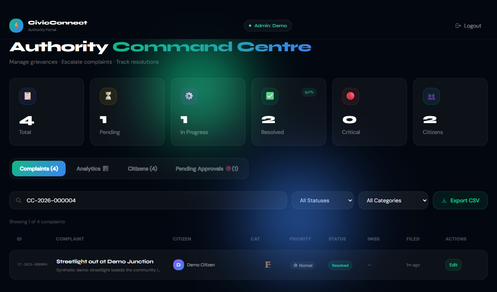
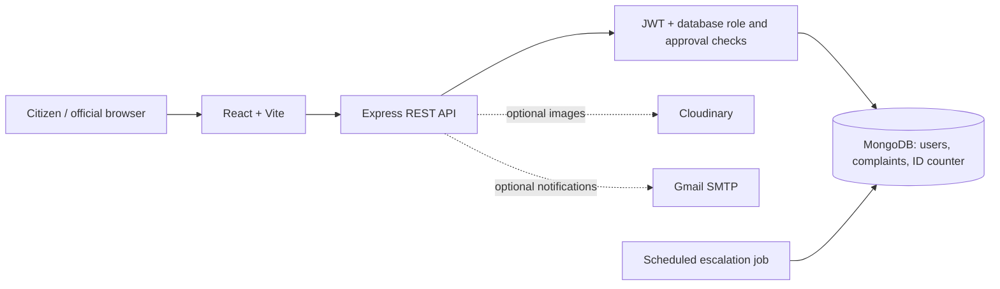

# CivicConnect

A React, Express and MongoDB civic grievance app. Citizens submit private complaints with copyable tracking IDs; approved officials communicate, record progress, escalate and resolve issues. Citizens review the activity timeline and rate resolutions. Public sharing is opt-in.

This portfolio demo is not a government service. Verification compares **synthetic demo codes** with an allowlist; it does not verify real Aadhaar identities. Do not enter real identity numbers.

## Architecture

Captured from the running local demo (synthetic data only):



[Complaint form](docs/screenshots/complaint-form-desktop.png) · [Citizen tracking on mobile](docs/screenshots/citizen-mobile.png)



The API owns authorization and validation. Mongoose stores chat, status history, escalation letters and ratings with each complaint. An atomic counter allocates tracking IDs. React provides dashboards, search, maps, charts and a public feed. Maps use external OpenStreetMap services; a written address is enough if map lookup fails.

## Quick local demo (Node only)

Use Node.js **22.12+** and npm. Install from both lockfiles:

```sh
git clone https://github.com/SatyaSailesh/civicconnect.git
cd civicconnect
npm ci --prefix backend
npm ci --prefix frontend
```

On Windows PowerShell use `npm.cmd` / `npx.cmd` if execution policy blocks `npm.ps1`. The first isolated MongoDB run downloads a MongoDB binary and requires internet access. No Atlas, Cloudinary or Gmail account is needed.

In terminal one:

```sh
npm run demo --prefix backend
```

In terminal two:

```sh
npm run demo --prefix frontend
```

Open **http://localhost:5174**. API health: **http://localhost:5001/health**. This uses a fresh temporary local MongoDB with synthetic fixtures, overrides application credentials and disables uploads/email. It does not use your configured database. Stop with Ctrl+C; restarting resets the temporary demo. Keep ports 5001 and 5174 free. An existing `frontend/.env.local` can override the demo API URL: remove that override or set it to `http://localhost:5001/api` for this mode.

| Account | Role / state | Demo verification code |
| --- | --- | --- |
| `citizen@example.test` | Citizen, initially unverified | `000000000001` |
| `other@example.test` | Second citizen | `000000000002` |
| `official@example.test` | Approved official | Not needed |
| `pending@example.test` | Official pending approval | Cannot sign in |

Initial password for all fixtures: **`Demo-password-2026!`**. Select **Govt Official** and enter **`demo-official-code`** for official login. These are intentionally public, local-only demo credentials.

## Persistent setup and first official

1. Start local MongoDB, for example `docker run --name civicconnect-mongo -p 127.0.0.1:27017:27017 -d mongo:7`. Restart an existing container with `docker start civicconnect-mongo`.
2. Copy root `.env.example` to `backend/.env`. Set `MONGO_URI=mongodb://127.0.0.1:27017/civicconnect_demo`. Generate `JWT_SECRET` with `node -e "console.log(require('node:crypto').randomBytes(32).toString('hex'))"`.
3. Set `ADMIN_WHITELIST=official@example.test,pending@example.test`, choose `ADMIN_SECRET_CODE`, and set `AADHAAR_WHITELIST=citizen@example.test:000000000001,other@example.test:000000000002`. Restart the API after environment changes.
4. Optionally copy `frontend/.env.example` to `frontend/.env.local`; the standard API defaults to `http://localhost:5000/api`.
5. Start `npm run dev --prefix backend` and `npm run dev --prefix frontend` in separate terminals. Open **http://localhost:5173**.
6. Register an official through the UI using its allowlisted email and authority code. It starts **pending**. From `backend`, run `npm run approve-admin -- official@example.test`. This trusted local command requires database access. Pending officials cannot sign in or approve themselves. Approved officials can approve subsequent accounts in the dashboard.
7. Register a citizen, sign in and complete synthetic verification before filing a complaint.

Optional fixtures: run `npm run seed:demo` from `backend`. This refuses remote URLs and databases other than local `civicconnect_demo`. It inserts missing accounts/complaints without deleting data, resetting passwords or reverting statuses; repeat runs preserve existing records. Seeded officials are explicitly approved demo fixtures. To demonstrate manual approval, use a fresh database and register through the UI instead. `backend/.env.demo.example` shows all local fixture settings.

## API access rules

- JWT verification is followed by a database lookup on every protected request. Current role and approval come from the account, so revoking approval also blocks previously issued tokens.
- Only verified citizens can file complaints. New records default to private in both route and schema; public sharing requires an explicit choice.
- `/complaints/my` returns the caller's records. Full detail, chat, deletion and ratings check ownership; approved officials can read, open chat, change status and escalate. Only owners can rate resolved complaints, using integer ratings from 1 to 5.
- Public feed and non-owner tracking of shared complaints use an explicit projection excluding private messages, account IDs, email, passwords, verification state, history and escalation letters. Shared names, descriptions, locations, photos and feedback are public, as stated in the form.
- Private tracking/full detail return `403` for another citizen. Citizen requests to official endpoints return `403`. UI hiding is not the security boundary.
- The shared authority code is an additional application gate, **not independent multifactor authentication**.

Authentication and verification endpoints have per-IP limits: registration 8/hour, login 10/15 minutes, synthetic verification 5/hour, and password changes 5/15 minutes. Limits use the in-memory express-rate-limit store, so they protect a single API process; multi-instance deployments should use a shared Redis-compatible store. The backend trusts one reverse proxy in production by default (`TRUST_PROXY` can override this); set it to match the actual hosting topology before deployment.

The frontend adds a Content Security Policy for Vercel, Vite development and Vite preview. It permits the current Render API host pattern, OpenStreetMap/Nominatim, Carto tiles, Cloudinary avatars and the existing Google Fonts/globe texture sources. If `VITE_API_URL` or `VITE_MAP_TILE_URL` uses another host, add that exact origin to the CSP before using it. Inline styles remain allowed because the current React UI and Leaflet map rely on style attributes; inline scripts and object plugins are blocked.

The current bearer JWT remains in `localStorage` for compatibility; this audit does not change session architecture. A migration should move authentication to secure `HttpOnly` cookies and pair state-changing requests with CSRF protection. Since the current Vercel and Render hosts are cross-site, cookie attributes, CORS credentials, CSRF token handling, logout, and token revocation must be designed and tested together before changing the frontend API client. An HttpOnly cookie prevents JavaScript from reading the token but does not prevent an XSS payload from making authenticated requests.

Owners can change sharing from an expanded complaint card. Making a complaint private removes it from subsequent public responses; it cannot recall copies already viewed. The public feed is accessible without signing in and supports search, area filters, and retry after a failed request. Signed-in citizens can choose a default area (or All areas); the map and duplicate suggestions use the same owner-or-public access rule. Settings save notification and map preferences to MongoDB, and profile name and Cloudinary-backed photo changes update the active session immediately. Photo upload requires Cloudinary credentials; without them the app explains that the optional upload is unavailable.

The citizen map searches accessible complaints by tracking ID or title, focuses the selected marker (including markers in clusters), and shows a written address when coordinates are absent. The report form supports a draggable manual pin. Nearby open reports in the same category are suggested before submission; the default `DUPLICATE_RADIUS_METERS=300` can be changed up to 10,000 m.

Department routing requires a category, exact city and state mapping in `DEPARTMENT_ROUTING_JSON`. There is no verified pilot jurisdiction in this repository, so the provided demo config has no mappings and new complaints enter **Admin Review Queue**. Add only mappings confirmed by the relevant authority. Each entry is JSON with `category`, `city`, `state`, `department`, `jurisdiction`, and `verified: true`; use `demo: true` only for clearly labeled non-production suggestions. Admin assignments and reassignments are written to complaint history. Citizens can edit before assignment or official action; afterward they can request a correction or withdraw. Withdrawals preserve the case and timeline, and stale edits return `409` so one party cannot silently overwrite concurrent staff work.

Settings also offers **Light map / Dark map**, with the same controls above citizen and official dashboard maps. The preference is saved to the account and restored on sign-in. Dark mode renders the existing basemap tiles with a dark color treatment; it does not change marker/status colors, heatmaps, attribution or the landing-page globe. The map keeps the same tile provider and optional `VITE_MAP_TILE_URL` configuration.

## Optional integrations

All three `CLOUDINARY_*` variables enable uploads: JPEG, PNG or WebP, two images maximum, 5 MB each. `EMAIL_USER` and `EMAIL_PASS` enable Gmail notifications with an app password. Credentials belong in ignored `backend/.env`. `/api/capabilities` exposes availability without secrets; the form explains disabled features. Text complaints and database status updates work without either integration. SMTP failure does not roll back a saved status.

From `backend`, `npm run check:integrations` uploads a synthetic one-pixel image to a unique path, deletes it, and checks SMTP authentication. It sends no email. Configuration presence does not guarantee provider health. See [verification findings](docs/VERIFICATION.md) for actual results and remaining advisories.

## Tests and checks

```sh
# Real isolated local MongoDB; no configured application DB is touched
npm run test:isolated --prefix backend

# Existing CI path: MongoDB on 27017; random test DB deleted afterward
npm test --prefix backend

npm run build --prefix frontend
npm run lint --prefix frontend
npm test --prefix frontend
npm audit --prefix backend
npm audit --prefix frontend

# First browser run only, or select an installed browser channel
cd frontend
npx playwright install chromium
npm run test:e2e
```

Installed Chrome on PowerShell: `$env:PLAYWRIGHT_CHANNEL='chrome'; npm.cmd run test:e2e`. Browser tests start isolated database/API/Vite servers, use separate citizen and official sessions, check desktop/mobile widths and write screenshots to ignored `frontend/test-results/`. Set `TEST_MONGO_PORT` for the ordinary backend test if local MongoDB uses another port. The isolated command selects a free port.

When Cloudinary credentials are present in `backend/.env`, set `$env:CIVICCONNECT_TEST_UPLOADS='1'` before the browser command to exercise profile photo upload, persistence in a second session, and removal. The isolated test server reads only the three Cloudinary values from that file; email remains disabled.

Integration assertions cover registration, synthetic verification, pending/revoked approval, private creation/tracking, ownership, public response filtering, sharing changes, saved preferences, profile validation, chat, escalation, history, ratings, map coordinates, duplicate/follow access, routing and review, correction/withdrawal permissions, stale updates, and unavailable uploads/email. Frontend unit tests cover CSV escaping and spreadsheet formula protection. GitHub Actions preserves the MongoDB integration test and production build and adds lint and frontend unit tests.

## Three-minute interview demo

Start the quick demo before the interview. Open normal and incognito windows.

1. **0:00–0:45 — Citizen:** log in as `citizen@example.test`, click **Verify Aadhaar**, enter `000000000001`, and explain verification is synthetic. Choose **New Complaint**. Title: **Streetlight out at Demo Junction**. Description: **Streetlight beside the community library is not working**. Address: **Demo Junction, Example Road, Hyderabad**. City: **Hyderabad**. Place a pin or enter coordinates, leave sharing unchecked, review any nearby matches, and submit without photos. Copy the tracking ID.
2. **0:45–1:45 — Official:** log in in the other window as `official@example.test`, choosing **Govt Official** and `demo-official-code`. Search the tracking ID and open the case. Show that no verified department mapping is configured, assign a demo department/jurisdiction from the review panel, open **Thread**, send a short message, then save **In Progress** and **Resolved** with feedback **Demo repair completed**.
3. **1:45–2:30 — Citizen:** search the tracking ID again and select **Show … on map** to focus the marker. Expand the complaint, show the resolution timeline and submit a five-star rating. Open **Public Feed** to select a local area or **All areas**, then switch to mobile width.
4. **2:30–3:00 — Engineering:** explain ownership checks, optimistic version conflicts and the fact that withdrawn cases retain history. Show the test commands and assertions proving a second citizen cannot access a private record, and acknowledge the SMTP and verified-department limitations.

Resume bullets grounded in the implemented workflow:

- Built a React/Express/MongoDB grievance workflow with searchable map pins, nearby duplicate suggestions, local public-feed filters, approved-official routing review, citizen correction/withdrawal history and resolution ratings.
- Added isolated MongoDB and separate-session browser coverage for ownership/privacy, concurrent-update conflicts, map focus, duplicate following, account photo persistence, official resolution and responsive layouts.

## Scope

Deployment to Render/Vercel is deferred. AI assistance, duplicate detection and roadmap expansions are outside this phase. Educational portfolio project by K. Satya Sai Sailesh.
